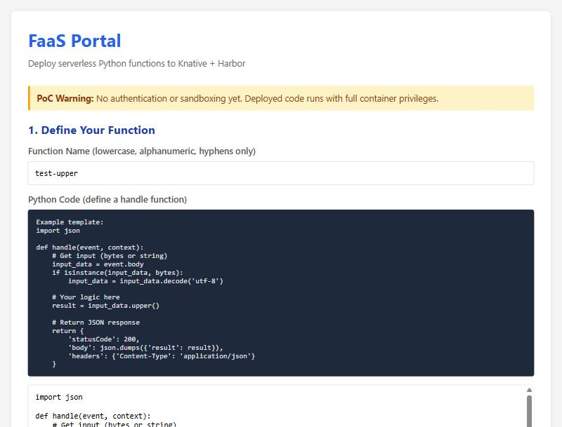
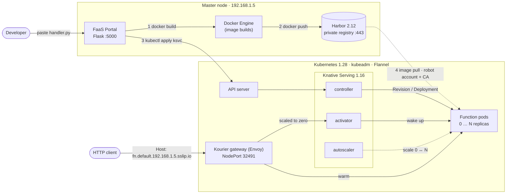

# knative-harbor-faas

**A self-hosted Functions-as-a-Service platform on bare-metal Kubernetes — Knative Serving, Kourier, a private Harbor registry, and a self-service deployment portal.**


This repository is a working proof of concept that answers one question:

> *Can a small team run its own serverless platform — private images, scale-to-zero, one-click
> deploys — entirely on premises, with open-source components only?*

It can. A developer pastes a Python `handle(event, context)` function into a web page; about a
minute later the function is a container image in a private registry and a scale-to-zero HTTP
endpoint on the cluster. Idle functions consume no pods, and the first request after idle is
served in under two seconds.



## Highlights

| | |
|---|---|
| **Scale-to-zero** | Functions run zero pods when idle and are started on demand by the Knative activator. |
| **Private registry** | All images live in a private Harbor project, pulled with a least-privilege robot account over TLS. |
| **Self-service portal** | Paste code → build → push → deploy → invoke, without touching Docker, `kubectl` or YAML. |
| **Bare metal** | Two-node `kubeadm` cluster, no cloud load balancer, no external DNS (NodePort + `sslip.io`). |
| **Portable functions** | A function built with the OpenFaaS `python3-http` template runs on Knative unchanged. |

## Measured results

Measured on the lab cluster (2 × Ubuntu 22.04 VMs, 4 vCPU / 4 GB), invoking `hello-client`
through the Kourier NodePort with [`scripts/cold-start-bench.sh`](scripts/cold-start-bench.sh):

| Metric | Result |
|---|---|
| Cold start (0 → 1 pod, image cached on node), 3 runs | **1.59 s – 2.04 s** (mean 1.75 s) |
| Warm invocation | **6 – 9 ms** |
| Scale back to zero after last request | ~90 s (60 s stable window + 30 s grace period) |
| Portal deploy, code to `Ready` endpoint | ~1 minute, dominated by `docker build` + push |

## Architecture



**Deploy path** — the portal writes the handler into a build context next to a fixed runtime
template, builds and pushes the image to Harbor, then applies a Knative `Service`. Knative
creates a Revision and its Deployment; the kubelet pulls the image from Harbor with the
`harbor-registry` pull secret.

**Request path** — clients call the Kourier NodePort with the function's hostname in the
`Host` header. If the function has pods, Envoy routes straight to them. If it is scaled to
zero, the request is held by the activator, the autoscaler brings up one pod, and the request
is forwarded as soon as the pod is ready.

More detail in [docs/architecture.md](docs/architecture.md).

## Stack

| Layer | Component | Version |
|---|---|---|
| OS | Ubuntu Server | 22.04 LTS |
| Orchestration | Kubernetes (`kubeadm`), Flannel CNI | 1.28.15 |
| Container runtime | containerd | 2.x |
| Serverless | Knative Serving | 1.16.0 |
| Ingress | Kourier (Envoy) | 1.16.0 |
| Registry | Harbor (Docker Compose install) | 2.12.1 |
| Image builds | Docker Engine | 29.x |
| Portal | Python 3 · Flask | — |
| Function runtime | `python:3.12-alpine` · Flask | — |

## Repository layout

```
.
├── docs/                 Architecture, setup guide, portal reference, troubleshooting
├── functions/            Sample functions (handler + Knative Service manifest each)
├── manifests/
│   ├── containerd/       Registry trust configuration for the nodes
│   ├── harbor/           harbor.yml example and certificate generation
│   ├── knative/          ConfigMap patches and the Service template
│   └── faas-portal.service
├── portal/               Self-service portal (Flask API, single-page UI, runtime template)
└── scripts/              Install, build, deploy, invoke and benchmark helpers
```

## Quick start

The full walkthrough, with explanations, is in [docs/setup-guide.md](docs/setup-guide.md).
On an existing `kubeadm` cluster the short version is:

```bash
# 1. Harbor with a self-signed certificate (master node)
HARBOR_ADMIN_PASSWORD='<choose>' HARBOR_DB_PASSWORD='<choose>' scripts/01-install-harbor.sh

# 2. Make every node trust the Harbor CA (run on each node)
scripts/02-trust-harbor-ca.sh /path/to/harbor.crt

# 3. Knative Serving + Kourier, configured for this registry
scripts/03-install-knative.sh

# 4. Pull secret from a Harbor robot account (project "client-demo")
ROBOT_TOKEN='<robot secret>' manifests/image-pull-secret.example.sh

# 5. Build, deploy and call a function
scripts/build-push.sh functions/number-stats tfunction
scripts/deploy.sh number-stats
scripts/invoke.sh tfunction '{"numbers": [3, 1, 4, 1, 5, 9]}'
```

```json
{"input": [3, 1, 4, 1, 5, 9], "stats": {"count": 6, "sum": 23, "average": 3.8333333333333335, "min": 1, "max": 9, "sorted": [1, 1, 3, 4, 5, 9]}}
```

To install the portal: `sudo scripts/install-portal.sh`, then open `http://<master-ip>:5000`.

## Writing a function

A function is a single Python file:

```python
import json

def handle(event, context):
    text = event.body.decode("utf-8")
    return {
        "statusCode": 200,
        "body": json.dumps({"result": text.upper()}),
        "headers": {"Content-Type": "application/json"},
    }
```

The handler contract and the sample functions (hello world, text transform, numeric stats,
PostgreSQL query with injected secrets) are documented in [functions/README.md](functions/README.md).

## Why Knative and not OpenFaaS?

The project started on OpenFaaS Community Edition. It was replaced because CE refused to
deploy images from the private Harbor registry, which was a hard requirement, and because
scale-to-zero is not part of CE. Knative Serving provides both under Apache-2.0, and the
function image already built for OpenFaaS ran on it without modification. The comparison
and migration notes are in [docs/openfaas-vs-knative.md](docs/openfaas-vs-knative.md).

## Documentation

| Document | Contents |
|---|---|
| [docs/architecture.md](docs/architecture.md) | Components, deploy and request flows, autoscaling, security model |
| [docs/setup-guide.md](docs/setup-guide.md) | Step-by-step installation from an empty `kubeadm` cluster |
| [docs/portal.md](docs/portal.md) | Portal API reference, configuration, internals |
| [docs/troubleshooting.md](docs/troubleshooting.md) | Every problem hit while building this, with cause and fix |
| [docs/openfaas-vs-knative.md](docs/openfaas-vs-knative.md) | Why the platform moved from OpenFaaS CE to Knative |
| [functions/README.md](functions/README.md) | Handler contract and sample functions |

## Limitations and roadmap

This is a proof of concept, built to validate the architecture rather than to be exposed to
untrusted users.

- [ ] **Portal authentication and multi-tenancy** — today anyone who can reach the portal can deploy; functions all land in the `default` namespace.
- [ ] **Isolated builds** — replace host `docker build` with in-cluster, rootless builds (Kaniko or BuildKit).
- [ ] **Per-function dependencies** — let a function ship its own `requirements.txt`.
- [ ] **Immutable image tags** — tag by content digest instead of `:latest` so redeploys always roll a new Revision.
- [ ] **Real ingress** — MetalLB + wildcard DNS + TLS instead of NodePort and `sslip.io`.
- [ ] **Function lifecycle in the portal** — list, logs, delete, revisions and traffic splitting.
- [ ] **Observability** — Prometheus metrics for request rate, latency and cold starts.

## License

[MIT](LICENSE) © 2026 Salim Msalmi
