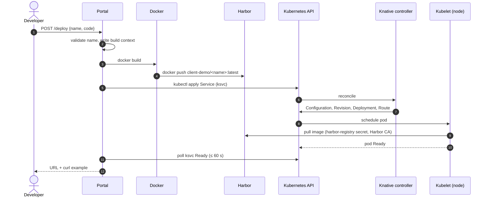
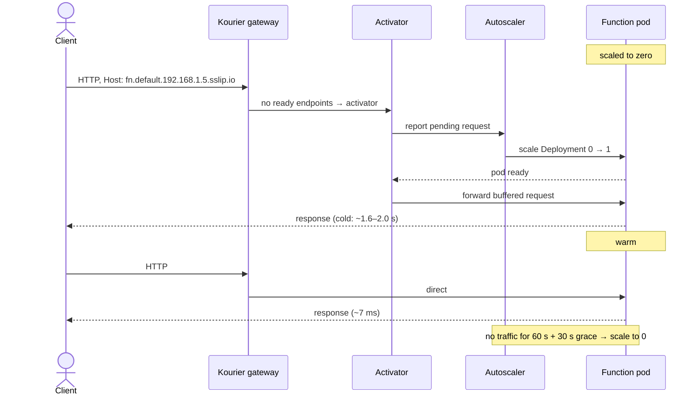

# Architecture

## Overview

The platform has three planes, all running on two virtual machines:

| Plane | Components | Where |
|---|---|---|
| **Developer** | FaaS Portal (Flask), Docker Engine for builds | Master node, outside Kubernetes |
| **Artifact** | Harbor registry (Docker Compose) | Master node, outside Kubernetes |
| **Runtime** | Kubernetes, Knative Serving, Kourier, function pods | Both nodes |

| Node | Role | Address |
|---|---|---|
| `kube-serverless-master` | Control plane, Harbor, portal, image builds | `192.168.1.5` |
| `kube-serverless-slave` | Worker | `192.168.1.6` |
| (external) | PostgreSQL used by the `db-query` sample | `192.168.1.7` |

Harbor and the portal deliberately run *next to* the cluster instead of *inside* it. The
registry must be available before the cluster can pull anything, and keeping it on plain
Docker Compose removes a bootstrap dependency (a cluster that needs its own registry to
start its own registry).

## Components

### Kubernetes

A `kubeadm` cluster, version 1.28.15, with Flannel (`10.244.0.0/16` pod network) and
containerd as the runtime. Nothing about the cluster is Knative-specific.

### Knative Serving 1.16

Knative adds the `Service` (ksvc), `Configuration`, `Revision` and `Route` resources. A
function is one `Service`; each change to its template produces an immutable `Revision`
backed by an ordinary Deployment.

| Pod (`knative-serving`) | Responsibility |
|---|---|
| `controller` | Reconciles ksvc → Configuration → Revision → Deployment |
| `autoscaler` | Decides the replica count from request concurrency, including zero |
| `activator` | Receives requests for scaled-to-zero revisions and buffers them until a pod is ready |
| `webhook` | Validates and defaults Knative resources |
| `net-kourier-controller` | Translates Knative routes into Envoy configuration |

Three ConfigMaps are changed from their defaults (see [`manifests/knative/`](../manifests/knative)):

| ConfigMap | Key | Value | Why |
|---|---|---|---|
| `config-network` | `ingress-class` | `kourier.ingress.networking.knative.dev` | Use Kourier as the networking layer |
| `config-domain` | `192.168.1.5.sslip.io` | `""` | Routable hostnames without running DNS |
| `config-deployment` | `registries-skipping-tag-resolving` | `192.168.1.5` | Let the kubelet, not the controller, talk to the self-signed registry |

### Kourier

Kourier is a small Envoy-based ingress built for Knative. On bare metal there is no cloud
load balancer, so the `kourier` Service's external IP stays `<pending>` and traffic enters
through its NodePort:

```
kourier   LoadBalancer   10.100.95.228   <pending>   80:32491/TCP,443:32069/TCP
```

Routing is by `Host` header. Each function gets
`<name>.<namespace>.192.168.1.5.sslip.io`; `sslip.io` is a public DNS service that resolves
any such name to the IP embedded in it, and callers without DNS can simply set the header:

```bash
curl -H "Host: hello-client.default.192.168.1.5.sslip.io" http://192.168.1.5:32491 -d 'ping'
```

### Harbor

Harbor 2.12.1 installed with the official installer under `/opt/harbor`, data in
`/data/harbor`, served over HTTPS on `192.168.1.5:443` with a self-signed certificate whose
SAN is the node IP.

- Project `client-demo` (private) holds one repository per function.
- Robot account `robot$client-demo+client-demo-robot` has push and pull on that project only.
- The robot credential exists in two places: the Docker credential store on the build host
  (for `docker push`) and the `harbor-registry` `kubernetes.io/dockerconfigjson` secret (for
  the kubelet).

Because the certificate is self-signed, every party that talks to the registry needs the CA:

| Client | Trust configuration |
|---|---|
| containerd on each node | `/etc/containerd/certs.d/192.168.1.5/{hosts.toml,ca.crt}` |
| Docker on the build host | `/etc/docker/certs.d/192.168.1.5/ca.crt` |
| System tools (`curl`, etc.) | `/usr/local/share/ca-certificates/` + `update-ca-certificates` |
| Knative controller | Not given the CA — tag resolution is skipped for this registry instead |

### FaaS Portal

A single Flask process ([`portal/app.py`](../portal/app.py)) managed by systemd, with a
static single-page UI. It shells out to `docker` and `kubectl` on the master node. Details
in [portal.md](portal.md).

### Function runtime

Every portal-built image is the same template
([`portal/templates/`](../portal/templates)) plus one user file:

```
python:3.12-alpine
└── /home/app/
    ├── index.py              Flask wrapper, listens on :8080
    └── function/handler.py   user code: handle(event, context)
```

Knative only requires a container that serves HTTP on the declared port, which is why the
OpenFaaS-built `hello-client` image (of-watchdog on `:8080`) also runs without changes.

## Deploy flow



## Request flow and autoscaling



Autoscaling settings in use (Knative defaults plus per-service annotations):

| Setting | Value | Source |
|---|---|---|
| `enable-scale-to-zero` | `true` | `config-autoscaler` default |
| `stable-window` | `60s` | `config-autoscaler` default |
| `scale-to-zero-grace-period` | `30s` | `config-autoscaler` default |
| `autoscaling.knative.dev/min-scale` | `0` | Service annotation |
| `autoscaling.knative.dev/max-scale` | `10` | Service annotation |

The measured cold start is mostly pod start-up: the image is already cached on the node
after the first pull, so the cost is scheduling, container creation, the Python interpreter
and Flask start, and Knative's readiness probe.

## Security model

What is in place:

- Registry traffic is TLS-only and certificate-verified (`skip_verify = false`).
- The cluster pulls with a project-scoped robot account, not an admin or user credential.
- Function containers run as a non-root user.
- Application secrets are injected from Kubernetes Secrets (see `functions/db-query`).
- No credential is stored in this repository; every example uses placeholders.

What is intentionally out of scope for the PoC, and listed on the roadmap:

- The portal is unauthenticated and runs as root with a cluster-admin kubeconfig.
- Builds use the host Docker daemon, so submitted code is built with host privileges.
- All functions share the `default` namespace with no NetworkPolicy or quotas.
- Traffic to functions is plain HTTP.

The platform must therefore stay on a trusted network.
