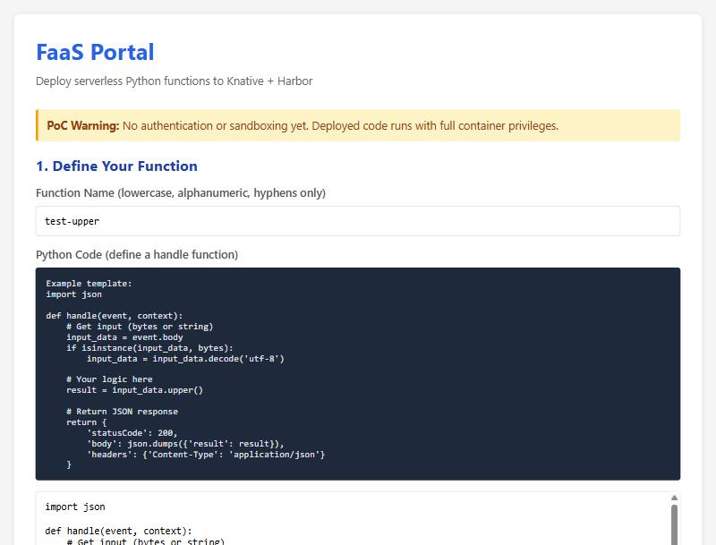

# FaaS Portal reference

The portal is the developer-facing part of the platform: a Flask backend
([`portal/app.py`](../portal/app.py)) and a dependency-free single-page UI
([`portal/static/index.html`](../portal/static/index.html)). It runs on the master node as
the `faas-portal` systemd service on port `5000`.



## What happens on "Deploy"

1. The function name is validated as a Kubernetes DNS-1123 label
   (`^[a-z0-9]([-a-z0-9]*[a-z0-9])?$`, at most 63 characters). The name becomes the image
   repository, the Knative Service name and the hostname.
2. A build context is created at `builds/<name>/`:
   ```
   builds/<name>/
   ├── Dockerfile          copied from templates/
   ├── index.py            copied from templates/ (HTTP wrapper)
   ├── requirements.txt    copied from templates/
   ├── function/handler.py the submitted code
   └── service.yaml        generated Knative Service
   ```
3. `docker build -t 192.168.1.5/client-demo/<name>:latest .`
4. `docker push` to Harbor, using the host's stored robot-account login.
5. `kubectl apply -f service.yaml`.
6. The `Ready` condition of the ksvc is polled every 2 s for up to 60 s.
7. The service URL and a ready-to-run `curl` command are returned.

## HTTP API

### `GET /`

Serves the UI.

### `POST /deploy`

Request:

```json
{
  "name": "text-upper",
  "code": "import json\n\ndef handle(event, context):\n    ..."
}
```

Success, `200`:

```json
{
  "success": true,
  "url": "http://text-upper.default.192.168.1.5.sslip.io",
  "nodeport_curl_example": "curl -H 'Host: text-upper.default.192.168.1.5.sslip.io' http://192.168.1.5:32491 -d 'your input'"
}
```

Errors:

| Status | `error` | Cause |
|---|---|---|
| `400` | `Function name is required` / `Invalid function name…` / `Function code is required` | Input validation |
| `500` | `Docker build failed` | `details` holds the build output |
| `500` | `Docker push failed` | Usually an expired or missing `docker login` |
| `500` | `Kubectl apply failed` | `details` holds the API server message |
| `500` | `Function deployment timed out` | Service not `Ready` within 60 s — see [troubleshooting](troubleshooting.md#portal-reports-function-deployment-timed-out) |

### `POST /invoke`

Proxies a request to a deployed function through the Kourier NodePort with the right `Host`
header, so the browser does not need to resolve `*.sslip.io`.

Request:

```json
{ "name": "text-upper", "input": "hello" }
```

Response, `200`:

```json
{ "success": true, "response": { "result": "HELLO", "message": "Portal test successful" } }
```

`response` is the parsed JSON body of the function when it is valid JSON, otherwise the raw
text.

## Configuration

All settings are environment variables with defaults matching the lab
([`portal/.env.example`](../portal/.env.example)). Set them as `Environment=` lines in the
systemd unit.

| Variable | Default | Purpose |
|---|---|---|
| `HARBOR_REGISTRY` | `192.168.1.5` | Registry host; also used as the Kourier node address |
| `HARBOR_PROJECT` | `client-demo` | Harbor project for function images |
| `KOURIER_NODEPORT` | `32491` | NodePort of the `kourier` Service |
| `DOMAIN_SUFFIX` | `<HARBOR_REGISTRY>.sslip.io` | Knative domain (`config-domain`) |
| `IMAGE_PULL_SECRET` | `harbor-registry` | Pull secret referenced by generated Services |
| `TEMPLATE_DIR` | `<portal dir>/templates` | Runtime template location |
| `BUILD_DIR` | `<portal dir>/builds` | Where build contexts are written |
| `PORTAL_PORT` | `5000` | Listen port |

Host requirements: Docker logged in to Harbor as the robot account, `kubectl` with a
kubeconfig allowed to manage Knative Services in `default`, Python 3.10+ with Flask.

## The runtime template

[`portal/templates/index.py`](../portal/templates/index.py) wraps the user's handler:

- one route, `/`, accepting `GET`, `POST`, `PUT`, `DELETE` and `PATCH`;
- builds `event` (`body`, `headers`, `method`, `path`) and `context` (`function_name`);
- accepts a `dict` return value with optional `statusCode`, `body` and `headers`;
- converts unhandled exceptions into a `500` JSON response with the exception type.

The image includes `flask`, `waitress` and `psycopg2-binary`; these are the libraries a
handler can import today.

## Operations

```bash
systemctl status faas-portal
journalctl -u faas-portal -f
ls /opt/faas-portal/builds/          # last build context of every function
kubectl get ksvc                     # everything the portal has deployed
kubectl delete ksvc <name>           # remove a function (not yet in the UI)
```

## Known limitations

- No authentication or authorisation; no per-user isolation.
- Builds run on the host Docker daemon as root.
- Redeploying under the same name reuses the `:latest` tag. Knative only rolls a new
  Revision when the Service template changes, so to pick up new code delete the Service
  first (`kubectl delete ksvc <name>`) or deploy under a new name.
- Deploys are synchronous; a slow build holds the HTTP request open.

These are tracked in the roadmap in the main [README](../README.md#limitations-and-roadmap).
