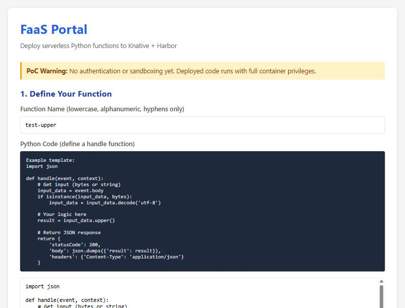

# FaaS Portal

A single-file Flask application that turns pasted Python code into a running Knative
Service. It is the "developer experience" layer of the PoC: no Docker, kubectl or YAML
knowledge is needed to deploy a function.



## What it does

1. Validates the function name against the Kubernetes DNS-1123 label rules.
2. Writes the pasted code to `builds/<name>/function/handler.py` and copies the runtime
   template (`templates/Dockerfile`, `index.py`, `requirements.txt`) next to it.
3. `docker build -t 192.168.1.5/client-demo/<name>:latest` and `docker push`.
4. Renders a Knative `Service` manifest (scale-to-zero, `imagePullSecrets: harbor-registry`)
   and `kubectl apply`s it.
5. Polls the ksvc `Ready` condition for up to 60 s and returns the URL plus a ready-made
   `curl` command.
6. `POST /invoke` proxies a test payload to the function through the Kourier NodePort with
   the correct `Host` header, so the browser never needs DNS for `*.sslip.io`.

Full API reference, sequence diagram and configuration table: [`docs/portal.md`](../docs/portal.md).

## Layout

```
portal/
├── app.py              Flask backend (/, /deploy, /invoke)
├── static/index.html   Single-page UI (vanilla JS)
├── templates/          Function runtime: Dockerfile, index.py (wrapper), requirements.txt
├── requirements.txt    Portal dependency (flask)
└── .env.example        Configuration reference
```

## Running

Host prerequisites: Docker logged in to Harbor, `kubectl` with an admin kubeconfig,
Python 3.10+.

```bash
# development
pip install -r requirements.txt
python3 app.py                      # http://localhost:5000

# production-ish (systemd) — installs to /opt/faas-portal
sudo ../scripts/install-portal.sh
sudo systemctl status faas-portal
journalctl -u faas-portal -f
```

## Security notice

This is a **proof of concept**. The portal has no authentication, executes `docker build`
on the host as root with user-supplied code, and uses a cluster-admin kubeconfig. Do not
expose it beyond a trusted lab network. The hardening roadmap is in the main README.
